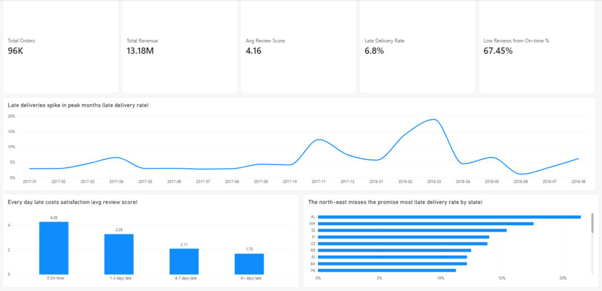
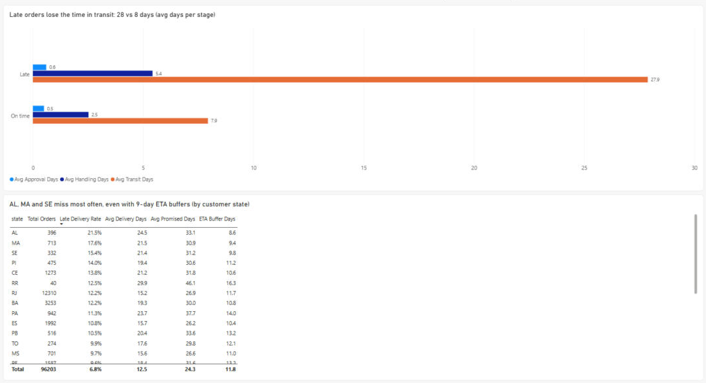
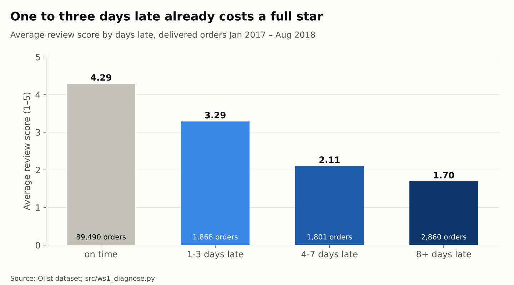
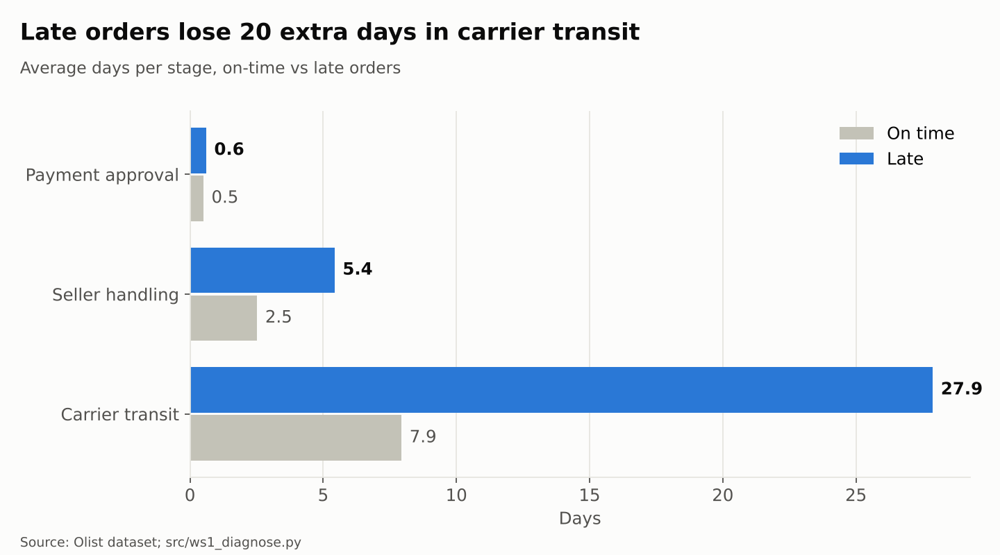
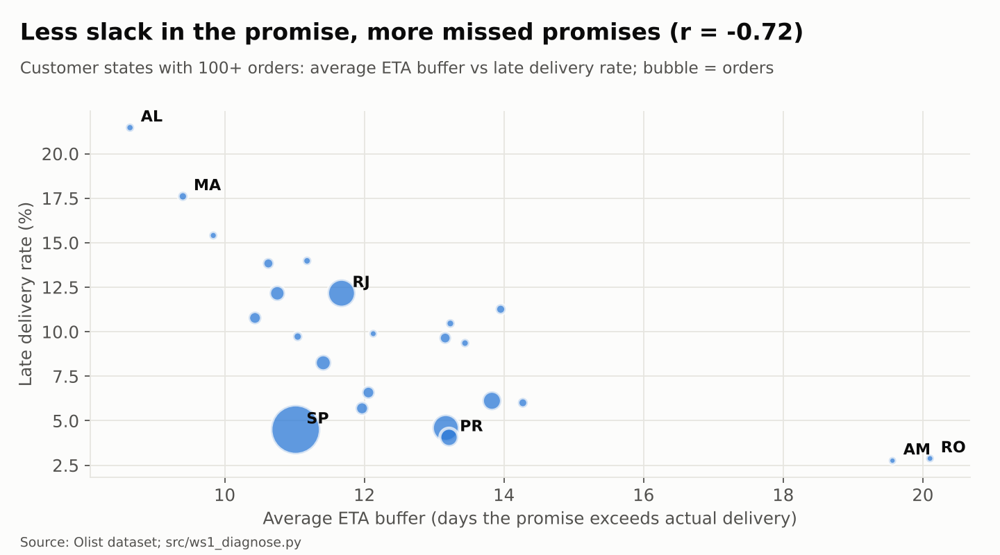
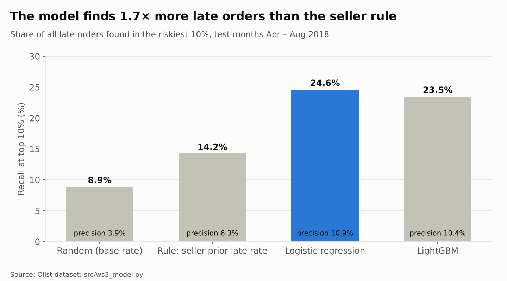

# Olist Delivery Intelligence

**Why do customers leave bad reviews, which orders will arrive late before they do, and which fix pays back first?**

An end-to-end Business Analyst case study on the public [Brazilian E-Commerce dataset by Olist](https://www.kaggle.com/datasets/olistbr/brazilian-ecommerce): 1.55 million rows across 9 tables, covering ~100k orders from 2016–2018.

> Portfolio project. The data is real. The stakeholders, costs and pilot are simulated, and every assumption is labelled.

---

## Early findings (D1 data profile)

| Signal | Value | Why it matters |
|---|---|---|
| Average review score: late vs on-time orders | **2.27 vs 4.29** | Delay hurts satisfaction badly |
| Low reviews (1–2★): late vs on-time orders | **62% vs 9%** | Late orders are ~7× more likely to get a bad review |
| Share of low reviews caused by late orders | **33%** | **Two in three bad reviews come from on-time orders**, so delivery is not the whole story |
| Promised vs actual delivery time | **24.3 vs 12.5 days** | ETAs are padded by ~12 days, yet 6.8% of orders still arrive late |
| Repeat customers | **3.1%** | A business case cannot rest on repeat purchases alone |

Analysis window: Jan 2017 – Aug 2018 (99,092 orders; 96,203 delivered).

---

## Results so far

| Workstream | Key result | Detail |
|---|---|---|
| WS0 Data Foundation | SQLite star schema, **19/19 data quality tests pass**; problem rows flagged, not deleted | [cleaning log](docs/data_cleaning_log.md) · [data dictionary](docs/data_dictionary.md) · [DQ report](docs/data_quality_report.md) |
| WS1 Diagnose | Late orders lose **+19.9 days in carrier transit** vs +2.9 at the seller; **72%** of late orders had an on-time seller. State late rate ranges 2.8%–21.5% and moves with the ETA buffer (r = −0.72): the promise is not calibrated by route | [findings](docs/ws1_findings.md) |
| WS2 Voice of Customer | Kit ready: taxonomy, 200-review labelling sample, local-LLM classifier and evaluator. Multi-seller orders have a **47%** low-review rate vs 12% | [runbook](docs/ws2_runbook.md) |
| WS3 Predict | Logistic regression catches **24.6%** of late orders in its top 10% vs **14.2%** for the seller-history rule, but only 1 in 9 alerts is right → conditional go, low-cost actions only | [model card](docs/model_card.md) |
| WS4 Design and Prove | Early warning **loses R$ 40.5k in year 1** at this volume (break-even at 12.7× volume) → recommend route-calibrated ETA + seller SLA; pilot needs **8,438 orders (~6 weeks)** | [FRD and pilot](docs/ws4_frd_and_pilot.md) · [business case](reports/excel/business_case.xlsx) · [seller scorecard](reports/excel/seller_scorecard.xlsx) |

### Power BI report

Two pages, 18 DAX measures on a star schema ([measures](reports/powerbi/measures.dax) · [build guide](reports/powerbi/BUILD_GUIDE.md)). Each chart title states the finding.





### Key charts

| | |
|---|---|
|  |  |
|  |  |

Process maps and wireframes: [As-Is](design/as_is_process.svg) · [To-Be](design/to_be_process.svg) · [Driver tree](design/driver_tree.svg) · [Seller portal](design/wireframe_seller_portal.svg) · [Ops dashboard](design/wireframe_ops_dashboard.svg)

---

## Approach

| Workstream | Question | Methods and tools |
|---|---|---|
| WS0 Data Foundation | Can we trust the data? | SQL layers (raw → staging → mart), data quality tests, star schema |
| WS1 Diagnose | Where and why does delay happen? | Power BI + DAX, process mining (pm4py), root-cause driver tree |
| WS2 Voice of Customer | What do unhappy customers complain about? | LLM review classification (local, LM Studio), validated on 200 human labels |
| WS3 Predict | Can we see a late order coming at payment approval? | scikit-learn / LightGBM, SHAP, compared with a simple seller-history rule |
| WS4 Design and Prove | What should we build, and does it pay back? | Excel business case (scenarios, sensitivity, break-even), FRD, Figma wireframe, pilot A/B design |

Business analysis artefacts: BRD v0.2, KPI dictionary (18 KPIs), 10 user stories with acceptance criteria, stakeholder map and RACI.

---

## Repository structure

```
data/raw/          Olist CSV files (not committed; see "Reproduce")
sql/01_raw/        Load raw tables into SQLite
sql/02_staging/    Typed, de-duplicated, translated tables
sql/03_mart/       Star schema: fact_orders, fact_order_items, dim_*
sql/tests/         Data quality tests
src/               Python scripts (profiling, features, LLM labelling)
notebooks/         Process mining and model notebooks
reports/powerbi/   Power BI report (.pbix)
reports/excel/     Seller scorecard and business case
design/            Process maps and wireframes
docs/              BRD, KPI dictionary, data profile, model card
```

---

## Reproduce

1. Download the dataset from [Kaggle](https://www.kaggle.com/datasets/olistbr/brazilian-ecommerce) and put the 9 CSV files in `data/raw/`.
2. Install Python packages: `pip install -r requirements.txt`
3. Run in order:
   ```
   python src/d1_profile.py data/raw      # D1 data profile
   python src/build_db.py data/raw        # WS0: database, tests, CSVs for Power BI
   python src/ws1_diagnose.py             # WS1: diagnostic tables
   python src/ws1_process_mining.py       # WS1: process mining
   python src/ws2_sample.py               # WS2: labelling sample (then see docs/ws2_runbook.md)
   python src/ws3_model.py                # WS3: risk model
   python src/ws4_build_excel.py          # WS4: Excel business case and scorecard
   python src/make_figures.py             # charts in reports/figures
   python src/make_diagrams.py            # process maps and wireframes in design/
   ```
4. Power BI: follow [reports/powerbi/BUILD_GUIDE.md](reports/powerbi/BUILD_GUIDE.md).

---

## Status

- [x] D1 Data profile
- [x] D2 BRD v0.2
- [x] D3 Stakeholder map and RACI
- [x] D4 Repository set-up
- [x] WS0 Data foundation: SQL pipeline, tests, cleaning log, data dictionary
- [x] WS1 Diagnose: analysis, process mining, DAX measures
- [x] WS1 Power BI report: 2 pages (Executive Overview, Delivery Stages)
- [x] WS2 kit: taxonomy, sample, classifier, evaluator
- [ ] WS2 human labels + LLM run (local LM Studio)
- [x] WS3 Predict: model, SHAP, model card
- [x] WS4 business case, seller scorecard, FRD, pilot plan
- [x] Process maps (As-Is, To-Be), driver tree, wireframes (SVG)
- [x] Executive deck (10 slides), interview prep, video script, LinkedIn draft
- [ ] Record the video and publish the post

---

## How AI was used

- Claude helped plan the project, draft documents and write and debug code. Every query, measure and number was reviewed and can be explained by the author.
- A local LLM (LM Studio) classifies review text in WS2, so review data never leaves the machine. Its accuracy is measured against human labels before results are used.

---

## Data and licence

Data: Olist, via Kaggle; see the dataset page for its licence terms. This repository contains analysis code and documents only, not the raw data.

**Author:** Maetasit Pittatanang · Business Analyst
