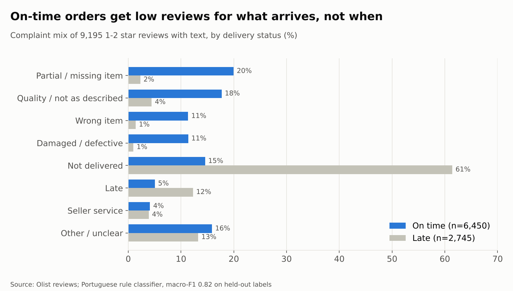

# WS2 Findings: Why customers complain

**Question:** WS1 showed that 67% of low reviews (1–2 stars) come from orders that arrived on time. What are those customers unhappy about?

**Answer:** what arrives, not when it arrives. In low reviews on on-time orders, **60% name a product or fulfilment problem**: partial or missing item 20%, quality or not as described 18%, wrong item 11%, damaged or defective 11%. Only 5% say "late".

## Results

| | On-time orders (n = 6,450) | Late orders (n = 2,745) |
|---|---:|---:|
| Partial / missing item | 20.0% | 2.3% |
| Quality / not as described | 17.7% | 4.4% |
| Wrong item | 11.3% | 1.4% |
| Damaged / defective | 11.4% | 1.0% |
| Not delivered | 14.6% | 61.4% |
| Late | 5.1% | 12.3% |
| Seller service | 4.1% | 3.9% |
| Other / unclear | 15.9% | 13.3% |

Base: 9,195 reviews with 1–2 stars and a written comment, delivered orders inside the analysis window.

## What this means

1. **Two problems, two fixes.** Late orders produce "where is my order?" reviews (61% say not delivered yet). The fix is the WS4 ETA and seller-SLA work. On-time orders produce product and fulfilment complaints. Faster delivery does not fix those, so a delivery-only programme leaves most low reviews untouched.
2. **Multi-seller orders look broken to the customer.** In orders with more than one seller, **48% of complaints are "partial or missing item"**, against 13% in single-seller orders. Items ship separately and the first box looks incomplete. A low-cost fix: tell the customer at checkout and in the first shipping email that the order comes in several boxes.
3. **"Delivered" but not received.** 15% of complaints on orders the system marks as delivered on time say the product never arrived. This points to a proof-of-delivery gap with the carrier. Worth a separate check of carrier scans against customer contacts.
4. **Seller quality is a lever.** Wrong, damaged and not-as-described items (40% of on-time complaints) belong in the seller scorecard (WS4) next to handover time.

## Method and how good it is

| Step | Detail |
|---|---|
| Taxonomy | 8 labels with Portuguese cue words and tie rules: [ws2_taxonomy.md](ws2_taxonomy.md) |
| Reference labels | 200 reviews (stratified sample), labelled by Claude against the taxonomy. A human spot-check is still pending, so treat these as AI reference labels, not human gold labels. |
| Classifier | Portuguese keyword rules in a fixed priority order ([src/ws2_rules.py](../src/ws2_rules.py)), tuned on reviews 1–100 only |
| Held-out test | Reviews 101–200: **accuracy 0.88, macro-F1 0.82** (bar 0.70: pass) |
| Random check | 60 random reviews from all 9,195: 46 correct (**77%**). Misses are mostly vague texts and typos that land in "other". |
| Baseline | TF-IDF + logistic regression trained on 100 labels: macro-F1 0.33. Too few labels for a statistical model, so rules win. |

**Limits.** "Other / unclear" (15%) is partly real misses, so the product and fulfilment shares are a lower bound. The labels are AI reference labels. A person should check at least 50 of them before these numbers go into a decision. The local LLM path ([ws2_runbook.md](ws2_runbook.md), LM Studio) remains the upgrade if higher recall is needed.

Files: [reports/ws2/label_sample.csv](../reports/ws2/label_sample.csv) (200 reference labels), [random60_check.csv](../reports/ws2/random60_check.csv), [rules_eval.csv](../reports/ws2/rules_eval.csv). Rebuilt by `python src/ws2_rules.py`: `data/processed/ws2/low_reviews_classified.csv` (all 9,195) and `data/processed/mart/fact_complaints.csv` (Power BI page 3).
